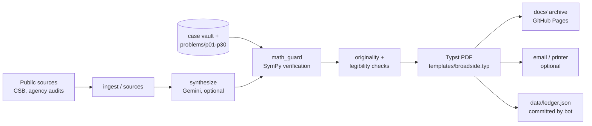

<p align="center"></p>

# Acta Problemata

[](https://github.com/omax404/acta-problemata/actions/workflows/ci.yml)
[](https://github.com/omax404/acta-problemata/actions/workflows/daily_gazette.yml)
[](https://omax404.github.io/acta-problemata/)
[](https://python.org)
[](LICENSE)

A daily, automated one-page broadside (A4 PDF) built around a real or realistic **industrial engineering problem**, for junior engineers (Morocco first). Every number is computed and checked by SymPy before it is published. Infrastructure cost: $0 (GitHub Actions + Pages).

**Live archive:** https://omax404.github.io/acta-problemata/

---

## How it works



- **Zero-secret mode:** with no API keys, the pipeline falls back to the vetted vault and still publishes.
- **Never blocks:** delivery failures (email, video) raise warnings, not failed editions. Pipeline failures open a GitHub issue.
- **Git is the database:** each edition is a bot commit (`data/ledger.json`, `docs/`, `badges/`).

## Honesty Rule (The Core of the Project)

Every sheet strictly carries one of two labels:

| Status | Meaning |
|---|---|
| **Cas public réel / Real public case** | Derived from an official public document (accident investigation, public tender, agency audit). The authoritative source is cited directly on the sheet. |
| **Problème réaliste / Realistic problem** | An industry-standard problem class typical of industrial sites. **No company is named and no private corporate need is claimed.** |

> [!IMPORTANT]
> A junior engineer must never claim *"I solved your problem"* when discussing a realistic problem. Sheets operate exclusively at the **sector and regional level** (e.g. *a dairy in Casablanca-Settat*). Company names appear only with verified public documentation.

---

## Quickstart

```bash
pip install -e ".[dev]"
cp .env.example .env        # all keys optional

acta preview                # compile a vault edition locally, offline
acta sheet today --out build/today.pdf
acta verify-vault           # run every vault case through the math guard
pytest -q                   # full test suite
```

Other commands: `acta run [--dry-run] [--force-vault]`, `acta check`, `acta request`, `acta mail-pull`, `acta sources-check`, `acta legibility`, `acta video`. Run `acta --help` for details.

### Motion companion (optional)
Each email can carry a ~10 s animated clip (GIF inline + MP4) rendered from `templates/video/index.html` with [HyperFrames](https://github.com/heygen-com/hyperframes). Needs `npm i -g hyperframes` and `ffmpeg`. Missing tools or a failed render just means the PDF is sent alone. Disable with `ACTA_VIDEO=off`.

---

## Layout

```
src/acta/        pipeline, math_guard, synthesize, sources, originality, legibility, render, ledger, mailbox, cli
problems/        p01-p30 parametrized problem generators (French-language)
templates/       Typst broadside + sheet, video composition
data/            case_vault, bank, ledger, sources registry
docs/            published GitHub Pages site (generated)
extras/          Cloudflare worker for the web request form, email and LaTeX styles
tests/           pytest suite
.github/         ci, daily_gazette, request, solution, sources_check workflows
```

**Legacy v1 (root `*.py` and `*.html` templates):** `gen_bank.py`, `build_archive.py`, `build_html.py`, `pick_edition.py`, `send_email.py`, `validate_bank.py`, `test_bank.py` are the original bank-and-archive generators. They still produce `data/bank/*.json` and the static archive pages, but the `acta` CLI is the current entry point.

---

## Adding a problem

1. Add `problems/pNN_<slug>.py` following `problems/common.py`.
2. `acta verify-vault && pytest -q`
3. Open a PR. CI builds a real PDF and uploads it as an artifact.

## License
MIT, see [LICENSE](LICENSE).
