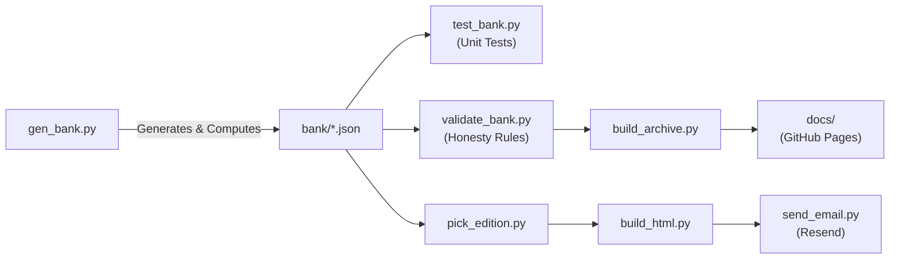

<p align="center"></p>

# Acta Problemata

[](https://github.com/omax404/acta-problemata/actions)
[](https://omax404.github.io/acta-problemata/)
[](https://python.org)
[](LICENSE)

A daily automated pipeline delivering real and realistic **industrial engineering problems** for junior engineers (Morocco first). Solve a challenge, document your engineering solution, and present it directly to companies.

**Archive publique en direct** : [https://omax404.github.io/acta-problemata/](https://omax404.github.io/acta-problemata/)

---

## Architecture & Pipeline



---

## Honesty Rule (The Core of the Project)

Every sheet strictly carries one of two labels:

| Status | Meaning |
|---|---|
| **Cas public réel / Real public case** | Derived from an official public document (accident investigation, public tender, agency audit). The authoritative source is cited directly on the sheet. |
| **Problème réaliste / Realistic problem** | An industry-standard problem class typical of industrial sites. **No company is named and no private corporate need is claimed.** |

> [!IMPORTANT]
> A junior engineer must never claim *"I solved your problem"* when discussing a realistic problem. Sheets operate exclusively at the **sector and regional level** (e.g. *a dairy in Casablanca-Settat*). Company names appear only with verified public documentation.

---

## Features

- **Mathematical Integrity**: Every numerical answer in `bank/*.json` is computed programmatically by `gen_bank.py` to prevent any statement/solution drift.
- **Interactive Archive**: Search with instant filtering (`/` hotkey), level filters (★☆☆ to ★★★), and random picker (`Au hasard`).
- **Print & Memo Ready**:
  - `Copier l'énoncé [MD]` button to copy the problem statement directly in Markdown for Notion, Word, or LaTeX reports.
  - One-click print/PDF generator with custom `@page` A4 styling.
  - KaTeX mathematical rendering with inline (`$ ... $`) and display (`$$ ... $$`) modes.
  - Keyboard navigation: `←` previous, `→` next, `Escape` to archive.
- **Honesty Validator (`validate_bank.py`)**: Fails automated builds if any "real" problem lacks complete provenance metadata.
- **Automated Test Suite (`test_bank.py`)**: Unit tests physics formulas and unit conversion sanity.

---

## Project Structure

```
bank/                    One JSON per problem (includes generated answer_key)
gen_bank.py              Generates bank/*.json with computed answer keys
validate_bank.py         Enforces honesty rules and schema compliance
test_bank.py             Unit test suite (physics, bounds, formatting)
pick_edition.py          Selects today's problem (day-of-year rotation)
build_html.py            Builds responsive email HTML (fr/en)
build_archive.py         Builds static docs/ archive site for GitHub Pages
send_email.py            Dispatches daily edition via Resend API
archive_template.html    Template for archive search & gallery
problem_template.html    Template for individual problem sheets
template.html            Template for daily email dispatches
requirements.txt         Python dependencies (Pillow)
.github/workflows/       daily.yml automated GitHub Actions cron workflow
```

---

## Quickstart & Local Setup

```bash
# 1. Install dependencies
pip install -r requirements.txt

# 2. Run automated test suite
python test_bank.py

# 3. Generate problem bank and validate
python gen_bank.py

# 4. Build archive site into docs/
python build_archive.py
```

### GitHub Pages Deployment
1. Go to repository **Settings → Pages**.
2. Under **Build and deployment**, select **Deploy from a branch**.
3. Set branch to `main` and folder to `/docs`.
4. Your archive is live at `https://<user>.github.io/acta-problemata/`.

---

## Adding a New Problem

1. Add a problem definition in `gen_bank.py` with physical parameters and formulas.
2. Run `python gen_bank.py` to compile it to `bank/` and check the printed answer key.
3. Run `python test_bank.py` to ensure all checks pass.
4. Run `python build_archive.py` to generate the updated static pages.
5. Commit and push.
